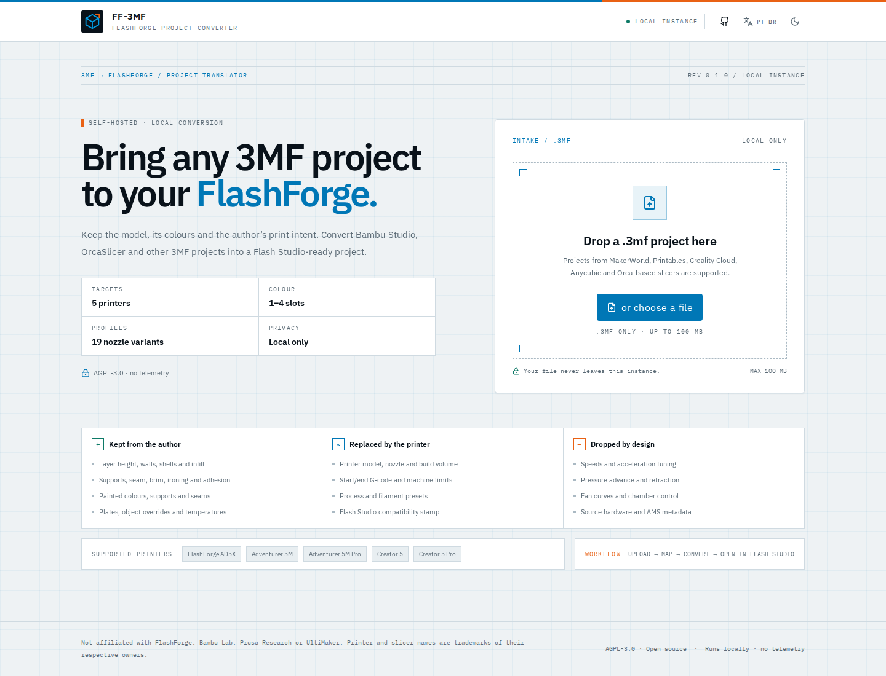
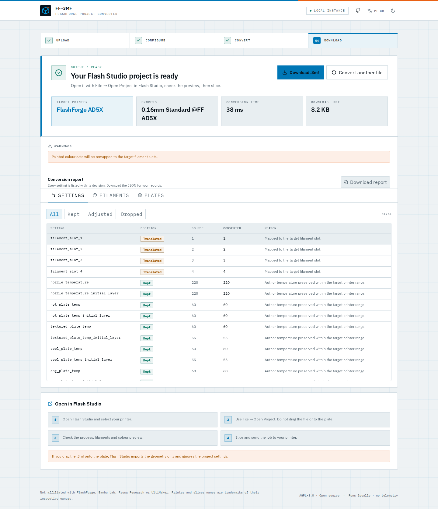
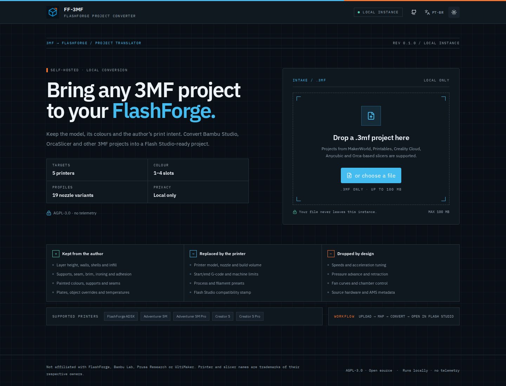
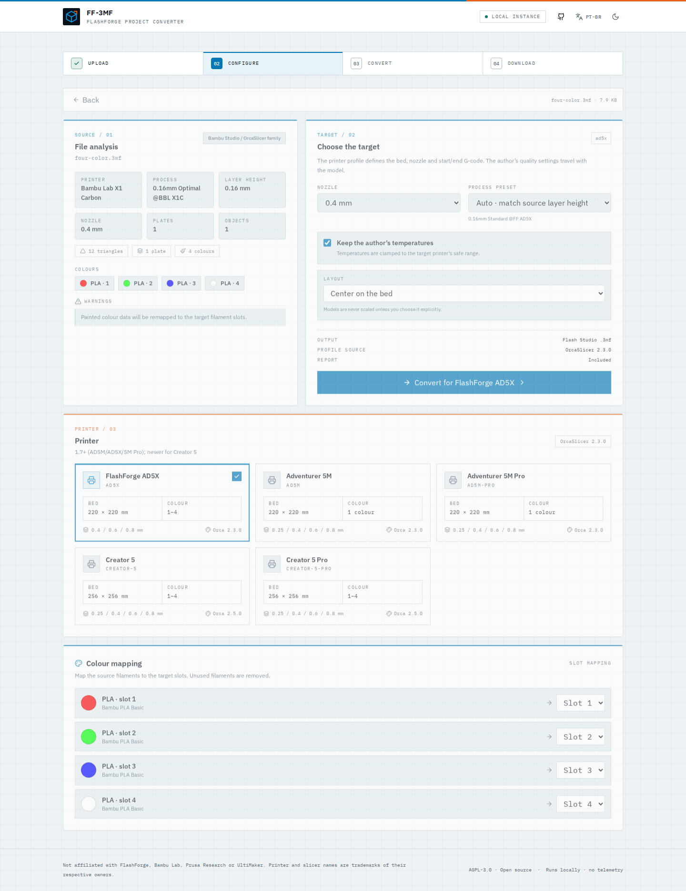

# FF-3MF Converter

[](https://github.com/GhsVilela/FF-3MF-Converter/actions/workflows/ci.yml)
[](https://github.com/GhsVilela/FF-3MF-Converter/actions/workflows/release.yml)
[](https://github.com/GhsVilela/FF-3MF-Converter/pkgs/container/ff-3mf-converter)
[](https://hub.docker.com/r/ghsvilela/ff-3mf-converter/tags)
[](LICENSE)

**Self-hosted 3MF project converter for FlashForge printers.**



FF-3MF takes a 3MF project from Bambu Studio, OrcaSlicer, Creality Print,
Anycubic Slicer Next, Snapmaker Orca or a compatible slicer, keeps the model,
plates, painted colours and the author's print intent, and writes a project that
Flash Studio opens with a FlashForge printer, process and filament profile.

The output is a **project**, not sliced G-code. Open it in Flash Studio with
**File → Open Project**, review the preview, then slice and print.



<details>
<summary>Dark theme</summary>



</details>

- [Features](#features)
- [Supported printers](#supported-printers)
- [Quick start](#quick-start)
- [How it works](#how-it-works)
- [Configuration](#configuration)
- [CLI](#cli)
- [API](#api)
- [Development](#development)
- [Testing](#testing)
- [Release images](#release-images)
- [Security and privacy](#security-and-privacy)
- [License](#license)

## Features

- **Self-hosted and local.** One container, no database, no cloud, no telemetry.
  Uploaded files are processed on your instance and removed automatically.
- **Keeps the author's intent.** Layer height, walls, shells, infill, supports,
  seam, brim, ironing, elephant-foot compensation, temperatures and painted
  colours travel with the model.
- **Replaces the machine.** Printer model, nozzle, bed shape, start/end G-code,
  machine limits and filament presets come from the target FlashForge profile.
- **Multicolour aware.** Painted triangles, per-object extruders and filament
  slots are remapped for the AD5X IFS and the Creator 5 toolheads. Single-colour
  printers get an explicit merge/select flow.
- **Optional colour preservation.** Projects with more colours than the target
  slots can keep one filament slot per source colour instead of merging, for
  manual mapping in Flash Studio.
- **Multi-plate projects.** Plates are preserved. Single-plate projects can be
  centred on the target bed; models are never scaled automatically.
- **Transparent report.** Every transferred setting is listed as kept, translated,
  clamped, replaced or dropped, with a reason. Download it as JSON.
- **No black box.** The target configuration is generated from pinned,
  open-source OrcaSlicer profiles and validated with the OrcaSlicer CLI.
- **Modern UI.** Drag and drop, printer cards, colour mapping, progress and a
  responsive report view. English and Portuguese (Brazil).
- **Runs without Docker.** Windows, Linux and macOS portable archives include a
  native launcher, the Node.js runtime and the printer profiles.

## Supported printers

| Printer           | Build volume       | Colours     | Nozzles                   |
| ----------------- | ------------------ | ----------- | ------------------------- |
| FlashForge AD5X   | 220 × 220 × 220 mm | 4 (IFS)     | 0.4 / 0.6 / 0.8 mm        |
| Adventurer 5M     | 220 × 220 × 220 mm | 1           | 0.25 / 0.4 / 0.6 / 0.8 mm |
| Adventurer 5M Pro | 220 × 220 × 220 mm | 1           | 0.25 / 0.4 / 0.6 / 0.8 mm |
| Creator 5         | 256 × 256 × 256 mm | 4 toolheads | 0.25 / 0.4 / 0.6 / 0.8 mm |
| Creator 5 Pro     | 256 × 256 × 256 mm | 4 toolheads | 0.25 / 0.4 / 0.6 / 0.8 mm |

Profiles are generated from [OrcaSlicer](https://github.com/OrcaSlicer/OrcaSlicer)
2.3.0 and 2.5.0. The AD5X, 5M and 5M Pro templates target the Flash Studio 1.7
generation; the Creator 5 templates use the newer OrcaSlicer profile set. See
[docs/printers.md](docs/printers.md) for details.

### Supported inputs

| Source                                                                                            | Support                 | Notes                                                                    |
| ------------------------------------------------------------------------------------------------- | ----------------------- | ------------------------------------------------------------------------ |
| Bambu Studio / OrcaSlicer / Creality Print / Anycubic Slicer Next / Snapmaker Orca / Flash Studio | Full project conversion | Same Orca-family 3MF layout                                              |
| PrusaSlicer                                                                                       | Experimental            | Geometry, painted colours and paint masks; settings are not imported yet |
| Cura                                                                                              | Geometry and placement  | Cura's print profile is not imported                                     |
| Generic 3MF (CAD, Microsoft 3D Builder, Fusion, SolidWorks)                                       | Geometry and materials  | Target defaults are used                                                 |
| Sliced `.gcode.3mf` print files                                                                   | Rejected                | Upload the original editable project instead                             |

## Quick start

> [!NOTE]
> The `:latest` container images and portable archives are produced by the
> release workflow. Until the first `v*.*.*` release is published, build from
> source with the commands in [Development](#development).

### Docker

GitHub Container Registry:

```bash
docker run -d \
  --name ff3mf \
  --restart unless-stopped \
  -p 8080:8080 \
  -v ff3mf_data:/data \
  ghcr.io/ghsvilela/ff-3mf-converter:latest
```

Docker Hub:

```bash
docker run -d \
  --name ff3mf \
  --restart unless-stopped \
  -p 8080:8080 \
  -v ff3mf_data:/data \
  docker.io/ghsvilela/ff-3mf-converter:latest
```

Open <http://localhost:8080>.

### Docker Compose

The equivalent stack:

```yaml
services:
  ff3mf:
    image: ${FF3MF_IMAGE:-ghcr.io/ghsvilela/ff-3mf-converter:latest}
    container_name: ff3mf
    restart: unless-stopped
    ports:
      - '8080:8080'
    volumes:
      - ff3mf_data:/data

volumes:
  ff3mf_data:
```

```bash
# GitHub Container Registry (default)
docker compose up -d

# Docker Hub
FF3MF_IMAGE=docker.io/ghsvilela/ff-3mf-converter:latest docker compose up -d
```

The included `docker-compose.yml` is a hardened version of the same stack with a
read-only root filesystem, a `tmpfs` for temporary runtime files, dropped
capabilities and a health check. Set `FF3MF_IMAGE` in `.env` or the environment
to switch registries. See [.env.example](.env.example) for optional settings.

### Windows, Linux and macOS executables

The release page includes portable archives that do not need Docker:

- **Windows x64:** `FF-3MF-Converter-<version>-win-x64.zip` — extract and run `FF-3MF.exe`.
- **Linux x64:** `FF-3MF-Converter-<version>-linux-x64.tar.gz` — extract and run
  `./ff3mf`.
- **macOS Apple Silicon:** `FF-3MF-Converter-<version>-macos-arm64.tar.gz` —
  extract and run `./ff3mf`.
- **macOS Intel:** `FF-3MF-Converter-<version>-macos-x64.tar.gz` — extract and
  run `./ff3mf`.

The Windows launcher embeds the multi-resolution FF-3MF icon in the `.exe`;
`FF-3MF.ico` is also included for shortcuts. The launcher starts the local
server, opens the browser and stores data in the user profile:

- Windows: `%LOCALAPPDATA%\FF-3MF\data`
- Linux: `$XDG_DATA_HOME/ff3mf` or `~/.local/share/ff3mf`
- macOS: `~/Library/Application Support/ff3mf`

The macOS builds are not signed with an Apple Developer ID and are not
notarized, so they can be built and distributed without an Apple Developer
account. If Gatekeeper blocks the first launch, remove the quarantine flag from
the extracted folder once:

```bash
xattr -dr com.apple.quarantine FF-3MF-Converter-<version>-macos-arm64
```

Use `macos-x64` on Intel Macs. You can also allow the launcher under **System
Settings → Privacy & Security → Open Anyway**, or download the archive with
`curl -L` instead of a browser, which does not set the quarantine flag.

Use `--no-browser`, `--port`, `--host` and `--data-dir` for custom setups.
SHA-256 checksums are attached as `SHA256SUMS.txt`.

### TrueNAS SCALE

Create a **Custom App** with:

- Image: `ghcr.io/ghsvilela/ff-3mf-converter:latest`
- Port: `8080` → container port `8080`
- Storage: a host path or dataset mounted at `/data`
- Environment: optionally set `AUTH_TOKEN`, `MAX_UPLOAD_MB`,
  `MAX_CONCURRENT_JOBS` and `JOB_TTL_MINUTES`

Use a host path for `/data` if you want to control cleanup and snapshots. The
container runs as UID/GID `1000:1000`; make sure the dataset is writable by that
user. No database or external service is required.

### Reverse proxy

The app serves both the UI and `/api` on port 8080. Put it behind Caddy, Traefik,
Nginx or your NAS reverse proxy and add HTTPS there.

Nginx example:

```nginx
server {
  listen 443 ssl;
  server_name ff3mf.example.com;

  client_max_body_size 100m;
  proxy_read_timeout 180s;
  proxy_send_timeout 180s;

  location / {
    proxy_pass http://127.0.0.1:8080;
    proxy_set_header Host $host;
    proxy_set_header X-Forwarded-Proto $scheme;
    proxy_set_header X-Forwarded-For $proxy_add_x_forwarded_for;
  }
}
```

If you serve the app under a subpath such as `/ff3mf/`, strip that prefix
before forwarding. See [docs/deployment.md](docs/deployment.md).

## How it works

1. **Analyse.** The container reads the 3MF ZIP, model XML, project settings,
   plates and painted attributes. Sliced print files are rejected.
2. **Map.** Source filaments are compacted and mapped to the target slots. The
   UI shows the mapping before you convert.
3. **Retarget.** A target template generated by headless OrcaSlicer supplies the
   complete Flash Studio configuration. FF-3MF overlays the author's quality
   settings and recomputes `different_settings_to_system`.
4. **Validate.** The output is reopened and checked for required entries,
   target identity, filament counts, paint ranges and config consistency before
   it is offered for download.

The result keeps the model, plates, painted colours and supports. It replaces
the printer, process and filament presets and drops tuning that belongs to the
source machine (speeds, acceleration, pressure advance, retraction, fan curves,
start/end G-code and hardware-specific keys).



### What the report contains

- Source app, printer, process, layer height, plates, objects and colours.
- Target printer, nozzle, process and filament presets.
- Per-setting decision: kept, translated, clamped, replaced or dropped.
- Filament mapping and plate fit results.
- Warnings, duration and output size.

## Configuration

| Variable                     | Default | Description                           |
| ---------------------------- | ------- | ------------------------------------- |
| `PORT`                       | `8080`  | HTTP port inside the container        |
| `DATA_DIR`                   | `/data` | Temporary uploads and converted files |
| `MAX_UPLOAD_MB`              | `100`   | Maximum upload size                   |
| `MAX_CONCURRENT_JOBS`        | `1`     | Conversions processed in parallel     |
| `MAX_QUEUED_JOBS`            | `10`    | Maximum queued conversions            |
| `JOB_TTL_MINUTES`            | `60`    | How long uploads and results are kept |
| `CONVERSION_TIMEOUT_SECONDS` | `120`   | Per-conversion timeout                |
| `AUTH_TOKEN`                 | unset   | Optional bearer token for `/api`      |
| `TRUST_PROXY`                | `false` | Trust `X-Forwarded-*` headers         |
| `LOG_LEVEL`                  | `info`  | Pino log level                        |
| `RATE_LIMIT_MAX`             | `120`   | Requests per rate-limit window        |

When `AUTH_TOKEN` is set, open the UI and enter the token. It is kept in the
browser tab's session storage. Use a reverse proxy for TLS and long-term access
control.

## CLI

The container includes the same conversion engine as the web app:

```bash
docker run --rm -v "$PWD:/work" ghcr.io/ghsvilela/ff-3mf-converter:latest \
  ff3mf convert /work/model.3mf \
    --printer ad5x \
    --nozzle 0.4 \
    --out /work/model_ad5x.3mf
```

Useful commands:

```bash
ff3mf printers
ff3mf analyze model.3mf
ff3mf convert model.3mf -p ad5m -o model_ad5m.3mf --report report.json
```

Run `ff3mf convert --help` for layout, colour mapping and temperature options.
Use `--keep-all-colors` to keep one filament slot per used source colour even
when the printer exposes fewer colour slots; verify the mapping in Flash Studio.

## API

| Method   | Endpoint                        | Description                                |
| -------- | ------------------------------- | ------------------------------------------ |
| `GET`    | `/api/health`                   | Health, version, profile manifest          |
| `GET`    | `/api/version`                  | Build metadata                             |
| `GET`    | `/api/printers`                 | Printers, nozzles, processes and materials |
| `POST`   | `/api/uploads`                  | Upload and analyse one `.3mf` file         |
| `POST`   | `/api/conversions`              | Start a conversion job                     |
| `GET`    | `/api/conversions/:id`          | Job status and report                      |
| `GET`    | `/api/conversions/:id/download` | Download the converted `.3mf`              |
| `DELETE` | `/api/conversions/:id`          | Delete a job and its output                |

All conversion endpoints accept and return JSON except the file upload and
download. See [docs/api.md](docs/api.md) for request and response examples.

## Development

Requirements: Node.js 22+ and npm; Go 1.22+ and Python 3 for portable builds;
Docker for the container build.

```bash
npm ci
npm run build:packages
npm run build -w @ff3mf/api
npm run dev
```

The API runs on <http://localhost:8080>; the Vite UI runs on
<http://localhost:5173> and proxies `/api` to the API.

Useful commands:

```bash
npm run lint
npm run typecheck
npm test
npm run build
npm run format
```

### Repository layout

```
apps/
  api/        Fastify API, job runner, static UI hosting
  web/        React + Vite + Tailwind UI
  cli/        ff3mf command-line interface
packages/
  core/       3MF reader/writer, paint codec, conversion engine
  profiles/   target profile loader and catalog
  shared/     shared types and Zod schemas
profiles/
  templates/  full target project_settings.config snapshots
  machines/   resolved machine configs
  processes/  process presets per printer/nozzle
  filaments/  filament presets per printer
docs/         architecture, conversion, printers, deployment, security
```

## Testing

```bash
npm run build:packages
npm test
```

The test suite covers:

- The TriangleSelector paint codec, including split trees and extended states.
- Four-colour conversion, single-colour merging and generic geometry fallback.
- Target identity, `different_settings_to_system`, filament counts and paint
  ranges in the output.
- The profile catalog and the five supported printers.
- Rejection of sliced `.gcode.3mf` files.

During development, converted projects are also sliced with the OrcaSlicer CLI
to verify that the embedded configuration is accepted. See
[docs/compatibility.md](docs/compatibility.md) for the manual Flash Studio
checklist.

## Release artifacts

Tags matching `v*.*.*` publish:

- Multi-arch container images:
  - `ghcr.io/ghsvilela/ff-3mf-converter`
  - `ghsvilela/ff-3mf-converter` on Docker Hub when `DOCKERHUB_ENABLED=true` is
    set as a repository variable and `DOCKERHUB_USERNAME` /
    `DOCKERHUB_TOKEN` secrets are configured.
- Portable Windows x64, Linux x64, macOS arm64 and macOS x64 archives with the
  native launcher, bundled Node.js runtime and profiles.
- `SHA256SUMS.txt` for the portable archives.

The `main` branch also publishes an `edge` tag. Container images are built for
`linux/amd64` and `linux/arm64` with SBOM and provenance attestations.

## Security and privacy

- Uploaded files are processed locally and cleaned up after `JOB_TTL_MINUTES`.
- No telemetry, analytics or external conversion service is used.
- ZIP bombs, path traversal, XXE, oversized files and unsafe archive paths are
  rejected or bounded.
- The container runs as a non-root user. The compose file uses a read-only root
  filesystem, a small `/tmp` tmpfs and `no-new-privileges`.
- Set `AUTH_TOKEN` if the app is reachable from an untrusted network. TLS and
  additional access control belong in your reverse proxy.

See [SECURITY.md](SECURITY.md) for the threat model and reporting process.

## License

AGPL-3.0-or-later. The target printer data and generated templates are derived
from the open-source OrcaSlicer/Orca-Flashforge profile ecosystem, which is also
AGPL-3.0-or-later. See [THIRD_PARTY_NOTICES.md](THIRD_PARTY_NOTICES.md).

## Disclaimer

FF-3MF Converter is not affiliated with, endorsed by, or sponsored by
FlashForge, Bambu Lab, Prusa Research, UltiMaker or any printer manufacturer.
Printer and slicer names are trademarks of their respective owners. Always
review a converted project in Flash Studio before printing.
